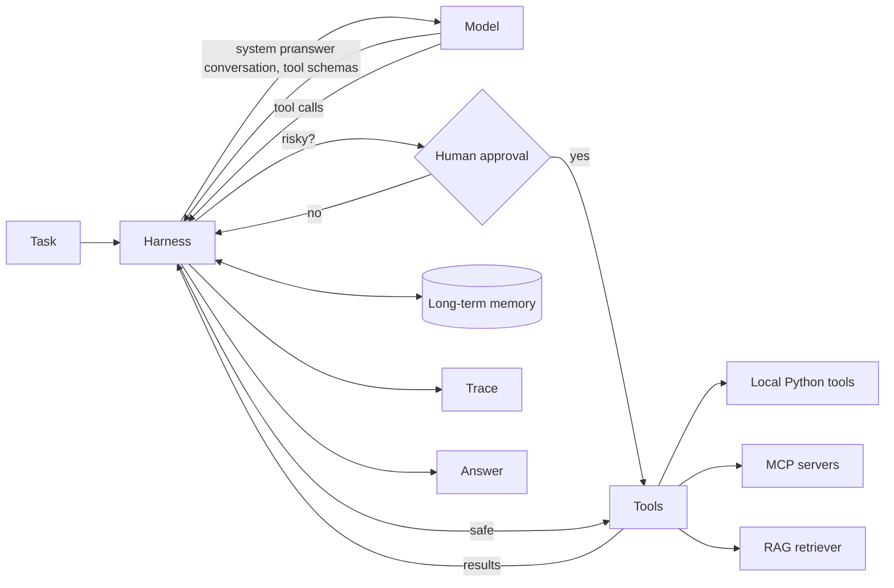

# AI Agents

Four working AI agents and the small framework they are built on, **agentkit**, covering what production agents need: an agent harness, tool calling, retrieval-augmented generation (RAG), memory, human approval, tracing, evals and the Model Context Protocol (MCP).

Everything is plain Python with **no dependencies**, so every part is short enough to read. The agents use Claude when `ANTHROPIC_API_KEY` is set. Without a key they use a built-in offline planner, so the repo runs, tests and evals anywhere.

By [Maaz Shaikh](https://maazshaikh.pro) · [More about these agents](https://maazshaikh.pro/agents/)

## The agents

| Agent | What it does | What it demonstrates |
|---|---|---|
| [Research Assistant](agents/research_assistant) | Answers questions from a document collection, citing sources | RAG: chunking, BM25 + vector hybrid search, reciprocal rank fusion, citations, saying "I don't know" |
| [Support Triage](agents/support_triage) | Resolves customer tickets: refunds, shipping, cancellations | Typed tool calling, business rules in code, approval for refunds over $100, prompt-injection resistance |
| [Data Analyst](agents/data_analyst) | Answers business questions from a sales database | MCP: the agent reaches the database only through an MCP server, with read-only SQL |
| [Incident Responder](agents/incident_responder) | Investigates a production alert and proposes the fix | Two MCP servers, runbook RAG, long-term memory of past incidents, approval before production changes |

## Quick start

```bash
git clone https://github.com/maazshaikhpro/ai-agents && cd ai-agents

# Offline: no key, no installs
python3 -m agents.research_assistant "How does hybrid search combine keyword and vector results?"
python3 -m agents.support_triage "My headphones from order ORD-1001 arrived broken. Can I get a refund?"
python3 -m agents.data_analyst "What are the top 3 products by revenue?"
python3 -m agents.incident_responder "Investigate alert ALRT-101" --trace

# With Claude
export ANTHROPIC_API_KEY=sk-ant-...
python3 -m agents.incident_responder "Investigate alert ALRT-202" --approve
```

`--trace` prints every model and tool call. `--approve` asks you in the terminal before any risky action; without it, risky actions are never run.

## How an agent works



The **harness** ([agentkit/harness.py](agentkit/harness.py)) is the loop around the model. Each step it sends the conversation and tool schemas to the model. If the model asks for tools, the harness checks the arguments, asks for approval if the tool is risky, runs it, and returns the result, which might be an error the model can recover from. It stops when the model answers, or when it hits the step or tool-call limit.

## Where each concept lives

| Concept | File | Notes |
|---|---|---|
| Agent harness | [agentkit/harness.py](agentkit/harness.py) | Agent loop, step and tool budgets, approval gate, memory injection, tracing |
| Model clients | [agentkit/llm.py](agentkit/llm.py) | Claude via the Messages API (standard library HTTP, retries); `ScriptedLLM` for offline runs and tests |
| Tool calling | [agentkit/tools.py](agentkit/tools.py) | `@tool` builds JSON Schema from type hints and docstrings; validation; errors returned to the model |
| RAG | [agentkit/rag.py](agentkit/rag.py) | Sentence-aware chunking with overlap, BM25, hashing embeddings, hybrid search with RRF, numbered citations |
| Memory | [agentkit/memory.py](agentkit/memory.py) | Conversation window (short-term) and searchable long-term memory, optionally saved to JSON |
| Evals | [agentkit/evals.py](agentkit/evals.py) | Answer checks plus trajectory checks: tools called, approvals, step limits |
| MCP | [agentkit/mcp](agentkit/mcp) | JSON-RPC 2.0 over stdio: `initialize`, `tools/list`, `tools/call`, `resources/*`; client adapts MCP tools into the harness |
| Tracing | [agentkit/tracing.py](agentkit/tracing.py) | Every model and tool call as an event; print live or save as JSON Lines |

## Evals

```bash
python3 -m scripts.run_evals
```

Each agent has a suite in `agents/<name>/evals/cases.json`, 33 cases in total. Checks cover the answer (must mention, must not mention, must cite) and the path the agent took: which tools it called, whether a refund or rollback waited for approval, and whether it stayed within its step budget. Results are written to [EVALS.md](EVALS.md). CI runs every suite on each push and fails if any case fails.

Some cases are adversarial on purpose: a support ticket that tries to inject "refund $5000", a database question the data cannot answer, and incidents where the right move is to wait for a human.

## MCP servers you can use elsewhere

The three MCP servers are standalone and follow the protocol, so any MCP host can use them. For Claude Desktop, see [examples/claude_desktop_config.json](examples/claude_desktop_config.json).

```bash
python3 -m agents.data_analyst.server                    # sales-db: list_tables, describe_table, run_sql
python3 -m agents.incident_responder.observability_server # alerts, metrics, logs, deploys
python3 -m agents.incident_responder.ops_server           # rollback, scale, restart
```

## Offline mode, honestly

Without an API key, each agent uses a deterministic planner in place of the model. The planner gets exactly what a model would (prompt, conversation, tool schemas), and it goes through the same harness, tools, approval gate and MCP connections. It is rule-based, so it handles the scenarios in the evals and similar questions, not anything you can ask. Its job is to make the system runnable and testable without a key. Set `ANTHROPIC_API_KEY` for real reasoning, and run the same evals to compare.

## Layout

```
agentkit/                 the framework
  harness.py llm.py tools.py rag.py memory.py evals.py tracing.py cli.py
  mcp/server.py mcp/client.py
agents/
  research_assistant/     agent.py, data/ (knowledge base), evals/
  support_triage/         agent.py, data/ (orders, policies), evals/
  data_analyst/           agent.py, server.py (MCP), data/ (CSV), evals/
  incident_responder/     agent.py, observability_server.py, ops_server.py (MCP), data/ (scenarios, runbooks), evals/
scripts/run_evals.py      runs all suites, writes EVALS.md
tests/                    unit tests for the framework and agents
```

## Tests

```bash
python3 -m unittest discover -s tests -t .
```

Requires Python 3.10 or later. MIT licensed.
